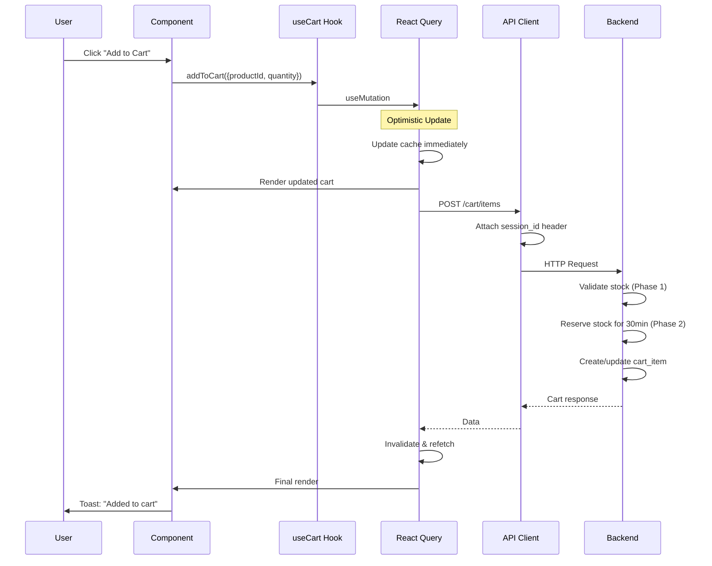
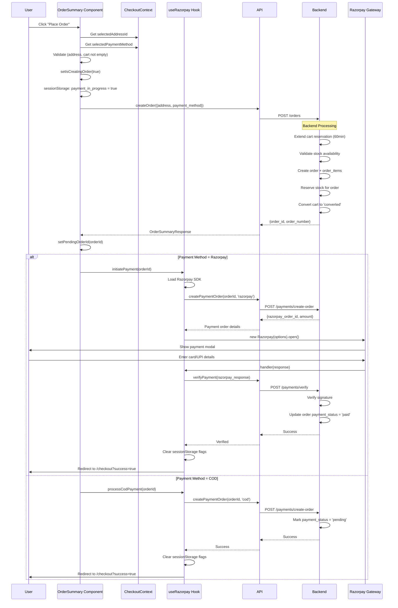

# Cart to Order Flow - Frontend Implementation Documentation

**Last Updated**: January 2026  
**Version**: 1.0.0

This document provides a comprehensive analysis of the frontend implementation for the complete cart-to-order flow in the Anant Enterprises e-commerce application.

---

## Table of Contents

1. [Architecture Overview](#architecture-overview)
2. [Technology Stack](#technology-stack)
3. [Complete User Journey](#complete-user-journey)
4. [Cart Implementation](#cart-implementation)
5. [Checkout Implementation](#checkout-implementation)
6. [Order Creation & Payment](#order-creation--payment)
7. [Data Flow Diagrams](#data-flow-diagrams)
8. [State Management](#state-management)
9. [Error Handling](#error-handling)
10. [Session & Authentication](#session--authentication)

---

## Architecture Overview

### High-Level Architecture

```
┌─────────────────┐    ┌──────────────────┐    ┌─────────────────┐
│  Product Pages  │───▶│   Cart System    │───▶│ Checkout System │
│  - Browse       │    │  - Add/Update    │    │  - Address      │
│  - Quick View   │    │  - View/Remove   │    │  - Payment      │
│  - Search       │    │  - Session Mgmt  │    │  - Discount     │
└─────────────────┘    └──────────────────┘    └─────────────────┘
                                │                        │
                                │                        ▼
                                │               ┌─────────────────┐
                                │               │  Payment Gateway│
                                │               │  - Razorpay     │
                                │               │  - COD          │
                                │               └─────────────────┘
                                │                        │
                                ▼                        ▼
                       ┌─────────────────────────────────────┐
                       │        Order Confirmation &         │
                       │          Order History              │
                       └─────────────────────────────────────┘
```

### Next.js App Router Structure

```
src/
├── app/
│   ├── (main)/            # Public routes
│   │   ├── cart/
│   │   │   └── page.tsx   # Cart page (public)
│   │   └── products/
│   │       └── [slug]/    # Product detail pages
│   ├── (protected)/       # Auth-required routes
│   │   ├── checkout/
│   │   │   └── page.tsx   # Checkout page
│   │   └── profile/
│   │       └── orders/    # Order history & details
│   └── layout.tsx
│
├── components/
│   ├── cart/              # Cart components
│   │   ├── client/        # Client-side interactive
│   │   └── server/        # Server-rendered
│   ├── checkout/          # Checkout components
│   │   ├── client/
│   │   └── server/
│   └── orders/            # Order display components
│
├── hooks/
│   ├── useCart.ts         # Cart state management
│   ├── useRazorpay.ts     # Payment gateway hook
│   └── queries/
│       └── orders/        # Order queries & mutations
│
├── contexts/
│   ├── CartDiscountContext.tsx  # Discount management
│   └── CheckoutContext.tsx      # Checkout state
│
├── queries/               # API client functions
│   ├── cart/
│   │   └── queries.ts     # Cart CRUD operations
│   └── orders/
│       └── queries.ts     # Order CRUD operations
│
└── types/
    ├── cart.ts
    └── order.ts
```

---

## Technology Stack

### Core Technologies

| Technology | Usage | Version |
|------------|-------|---------|
| **Next.js** | App Router, SSR/CSR | 14+ |
| **React** | UI Components | 18+ |
| **TypeScript** | Type safety | 5+ |
| **TanStack Query** | Server state management | 5+ |
| **Framer Motion** | Animations | Latest |
| **Razorpay** | Payment processing | Latest |
| **Sonner** | Toast notifications | Latest |

### State Management Patterns

1. **Server State**: TanStack Query (React Query)
   - Cart data
   - Order data
   - User addresses
   - Product inventory

2. **Client State**: React Context + useState
   - Checkout form state
   - Payment processing state
   - Cart session (for guests)
   - Discount codes

3. **URL State**: nuqs (for products/filters)
   - Not used in cart/checkout flow
   - Used in product listing pages

---

## Complete User Journey

### Flow Diagram

```
┌────────────┐
│  Browse    │
│  Products  │
└──────┬─────┘
       │
       ▼
[Add to Cart Button]
       │
       ├──▶ Is User Logged In?
       │    ├─ Yes ─▶ Cart attached to user_id
       │    └─ No ──▶ Cart attached to session_id
       │
       ▼
┌────────────────┐
│  Cart Page     │ ◀──── Can view/edit cart
│  (/cart)       │       (Public - no auth)
└────────┬───────┘
         │
         │ [Proceed to Checkout]
         │
         ▼
   [Auth Check]
         │
         ├─ Not Logged In ─▶ Redirect to /login?redirect=/checkout
         │                   (Cart merges after login)
         └─ Logged In ──┐
                        │
                        ▼
              ┌──────────────────┐
              │  Checkout Page   │
              │  (/checkout)     │
              │                  │
              │  1. Cart Items   │────▶ Read-only view
              │  2. Address      │────▶ Select/Add address
              │  3. Payment      │────▶ Razorpay/COD
              │  4. Discount     │────▶ Apply coupon codes
              │  5. Summary      │────▶ Total calculation
              └────────┬─────────┘
                       │
                       │ [Place Order]
                       │
                       ▼
              ┌──────────────────┐
              │  Order Creation  │
              │  (API Call)      │
              └────────┬─────────┘
                       │
                ┌──────┴──────┐
                │             │
                ▼             ▼
        [Razorpay]      [Cash on Delivery]
                │             │
                │             │
       ┌────────┴─────┐       │
       │  Razorpay    │       │
       │  Modal Opens │       │
       │  - Enter Card│       │
       │  - UPI       │       │
       │  - Net Banking       │
       └────────┬─────┘       │
                │             │
                ▼             ▼
         [Payment Success/Failure]
                │             │
                └──────┬──────┘
                       │
                       ▼
              ┌──────────────────┐
              │  Order Success   │
              │  Page            │
              │  (/checkout?     │
              │   success=true)  │
              └──────────────────┘
                       │
                       ▼
              ┌──────────────────┐
              │  Profile/Orders  │
              │  (/profile/      │
              │   orders/[id])   │
              └──────────────────┘
```

---

## Cart Implementation

### File Structure

```
components/cart/
├── client/
│   ├── CartContent.tsx           # Wrapper with session management
│   ├── CartItemsList.tsx         # Display cart items (client)
│   ├── CartSummary.tsx           # Order summary sidebar
│   └── CartItemControls.tsx      # +/- quantity controls
├── CartDrawer.tsx                # Mobile cart drawer
├── FloatingCartButton.tsx        # Floating cart badge
└── CartAuthSync.tsx             # Merge guest → user cart

hooks/
├── useCart.ts                    # Main cart hook (facade)
└── cart/
    └── useCartSession.ts         # Session ID management
```

### Cart Page Component

**File**: `src/app/(main)/cart/page.tsx`

```tsx
// Server Component (renders structure)
export default async function CartPage() {
  // Fetch upsell products server-side
  const upsellProducts = await getUpsellProducts();

  return (
    <CartContent>  {/* Client wrapper */}
      <div className="container">
        <h1>Shopping Cart</h1>

        <div className="grid lg:grid-cols-12 gap-8">
          {/* Left: Cart Items (Client Island) */}
          <div className="lg:col-span-8">
            <FreeShippingProgress />   {/* Client */}
            <CartItemsList />          {/* Client */}
          </div>

          {/* Right: Summary (Client Island) */}
          <div className="lg:col-span-4">
            <CartSummary />            {/* Client */}
          </div>
        </div>
      </div>
    </CartContent>
  );
}
```

**Key Features**:
- ✅ Public route (no auth required)
- ✅ Server component shell with client islands
- ✅ Works for both logged-in and guest users

### useCart Hook (Main Cart Interface)

**File**: `src/hooks/useCart.ts`

```typescript
export function useCart() {
  // React Query for cart data
  const { data: cartItems, isLoading, refetch } = useCartQuery();

  // Mutations
  const addMutation = useAddToCartMutation();
  const updateMutation = useUpdateCartItemMutation();
  const removeMutation = useRemoveCartItemMutation();

  // Facade functions
  const addToCart = async ({
    productId,
    quantity = 1,
    bundleId,
    productDetails  // For optimistic updates
  }) => {
    await addMutation.mutateAsync({
      productId,
      quantity,
      bundleId,
      productDetails
    });
  };

  const updateQuantity = async (id: string, change: number) => {
    // Validates max stock, updates quantity
    // ...
  };

  const removeFromCart = async (id: string) => {
    await removeMutation.mutateAsync(id);
  };

  return {
    cartItems,          // Transformed cart items
    isLoading,
    addToCart,
    removeFromCart,
    updateQuantity,
    getTotalItems,      // Derived: sum of quantities
    getTotalPrice,      // Derived: sum of (price * qty)
    isAdding,           // Mutation loading states
    isUpdating,
    isRemoving,
  };
}
```

**Key Features**:
- ✅ Single facade for all cart operations
- ✅ Optimistic updates via React Query
- ✅ Automatic cache invalidation
- ✅ Session-aware (auto-attaches session_id for guests)

### Cart Query Implementation

**File**: `src/queries/cart/queries.ts`

```typescript
import { api } from '@/api';
import { CartResponse } from '@/types/cart';

export function getCartSessionId(): string {
  // Check localStorage for session ID
  let sessionId = localStorage.getItem('cart_session_id');
  
  if (!sessionId) {
    // Generate new UUID
    sessionId = crypto.randomUUID();
    localStorage.setItem('cart_session_id', sessionId);
  }
  
  return sessionId;
}

export async function getCart(): Promise<CartResponse> {
  const sessionId = getCartSessionId();
  
  return api<CartResponse>('/cart', {
    method: 'GET',
    sessionId,  // Auto-attached as x-session-id header
    // auth: false (cart is public)
  });
}

export async function addToCart(data: AddToCartData) {
  const sessionId = getCartSessionId();
  
  return api('/cart/items', {
    method: 'POST',
    body: data,
    session Id,
  });
}

export async function updateCartItem(
  itemId: string,
  data: UpdateCartItemData
) {
  const sessionId = getCartSessionId();
  
  return api(`/cart/items/${itemId}`, {
    method: 'PUT',
    body: data,
    sessionId,
  });
}

export async function removeCartItem(itemId: string) {
  const sessionId = getCartSessionId();
  
  return api(`/cart/items/${itemId}`, {
    method: 'DELETE',
    sessionId,
  });
}
```

**Session Management Flow**:

```
┌────────────────┐
│  Guest User    │
└────────┬───────┘
         │
         │ Adds to cart
         ▼
  [Check localStorage]
         │
    No session_id?
         │
         ├─▶ Generate UUID
         │   Store in localStorage
         │   (cart_session_id)
         │
         ▼
  [API Call with session_id]
         │
         ▼
  Backend creates cart with session_id
  
  
┌────────────────┐
│  User Logs In  │
└────────┬───────┘
         │
         ▼
  [CartAuthSync Component]
         │
         ├─▶ Calls mergeCart API
         │   (sends old session_id)
         │
         ▼
  Backend merges guest cart → user cart
         │
         ▼
  Clear session_id from localStorage
```

### Optimistic Updates Pattern

```typescript
export function useAddToCartMutation() {
  const queryClient = useQueryClient();

  return useMutation({
    mutationFn: addToCartFn,
    
    // 1. BEFORE API call - update UI immediately
    onMutate: async (newItem) => {
      // Cancel ongoing queries
      await queryClient.cancelQueries({ queryKey: CART_QUERY_KEY });
      
      // Snapshot current state
      const previousCart = queryClient.getQueryData(CART_QUERY_KEY);
      
      // Optimistically update cache
      queryClient.setQueryData(CART_QUERY_KEY, (old) => ({
        ...old,
        items: [...old.items, {
          id: `temp-${Date.now()}`,  // Temporary ID
          ...newItem,
        }],
        itemCount: old.itemCount + 1,
      }));
      
      return { previousCart };  // For rollback
    },
    
    // 2. ON ERROR - rollback to previous state
    onError: (err, variables, context) => {
      queryClient.setQueryData(CART_QUERY_KEY, context.previousCart);
      toast.error('Failed to add to cart');
    },
    
    // 3. AFTER SUCCESS - refetch to sync with server
    onSettled: () => {
      queryClient.invalidateQueries({ queryKey: CART_QUERY_KEY });
    },
  });
}
```

**Benefits**:
- ✅ Instant UI feedback (no loading spinner)
- ✅ Automatic rollback on error
- ✅ Server sync after success

---

## Checkout Implementation

### File Structure

```
components/checkout/
├── client/
│   ├── CheckoutGuard.tsx         # Redirects if cart empty
│   ├── ShippingAddressSection.tsx # Address selection
│   ├── OrderSummaryClient.tsx     # Place order button
│   └── CheckoutProgress.tsx       # Visual steps indicator
├── server/
│   ├── CartItemsDisplay.tsx       # Read-only cart view
│   ├── PaymentMethodDisplay.tsx   # Payment options
│   └── OrderSummaryDisplay.tsx    # Price breakdown + order creation
└── CheckoutBanner.tsx             # Trust badges

contexts/
└── CheckoutContext.tsx             # Shared state
```

### Checkout Page Component

**File**: `src/app/(protected)/checkout/page.tsx`

```tsx
export default async function CheckoutPage() {
  // Only fetch upsell server-side
  const upsellProducts = await getUpsellProducts();

  return (
    <CheckoutProvider>   {/* Context wrapper */}
      <Suspense fallback={null}>
        <CheckoutGuard />  {/* Redirects if cart empty */}
      </Suspense>
      
      <CheckoutBanner />

      <div className="container">
        <div className="grid lg:grid-cols-12 gap-8">
          {/* Left Column */}
          <div className="lg:col-span-7">
            <CartItemsDisplay />       {/* Server component */}
            <PaymentMethodDisplay />   {/* Server component */}
            <OrderSummaryDisplay />    {/* Client - handles order */}
          </div>

          {/* Right Column */}
          <div className="lg:col-span-5">
            <ShippingAddressSection /> {/* Client */}
            <CheckoutUpsellClient />   {/* Client */}
          </div>
        </div>
      </div>
    </CheckoutProvider>
  );
}
```

**Key Features**:
- ✅ Protected route (requires auth)
- ✅ CheckoutGuard prevents access with empty cart
- ✅ Mixed server/client components for performance

### CheckoutContext (Shared State)

**File**: `src/contexts/CheckoutContext.tsx`

```typescript
interface CheckoutContextType {
  selectedAddressId: string | null;
  setSelectedAddressId: (id: string | null) => void;
  
  selectedPaymentMethod: string;
  setSelectedPaymentMethod: (method: string) => void;
  
  isPaymentProcessing: boolean;
  setIsPaymentProcessing: (isProcessing: boolean) => void;
}

export function CheckoutProvider({ children }) {
  const [selectedAddressId, setSelectedAddressId] = useState(null);
  const [selectedPaymentMethod, setSelectedPaymentMethod] = 
    useState('razorpay');  // Default
  const [isPaymentProcessing, setIsPaymentProcessing] = useState(false);

  return (
    <CheckoutContext.Provider value={{
      selectedAddressId,
      setSelectedAddressId,
      selectedPaymentMethod,
      setSelectedPaymentMethod,
      isPaymentProcessing,
      setIsPaymentProcessing,
    }}>
      {children}
    </CheckoutContext.Provider>
  );
}

export function useCheckout() {
  // Hook to access context
  const context = useContext(CheckoutContext);
  if (!context) throw new Error('Must be used within CheckoutProvider');
  return context;
}
```

**Usage in Components**:

```tsx
// In ShippingAddressSection.tsx
const { selectedAddressId, setSelectedAddressId } = useCheckout();

// In OrderSummaryDisplay.tsx
const { selectedPaymentMethod, selectedAddressId } = useCheckout();
```

### CheckoutGuard (Empty Cart Protection)

**File**: `src/components/checkout/client/CheckoutGuard.tsx`

```tsx
'use client';

export function CheckoutGuard() {
  const router = useRouter();
  const { data: cart, isLoading } = useRawCartQuery();
  const { isPaymentProcessing } = useCheckout();

  useEffect(() => {
    // Don't redirect if payment in progress
    if (isPaymentProcessing) return;
    
    // Check sessionStorage flag (set during order creation)
    if (sessionStorage.getItem('payment_in_progress') === 'true') {
      return;
    }

    // If cart loaded and empty, redirect to cart page
    if (!isLoading && !cart?.items?.length) {
      toast.error('Your cart is empty');
      router.push('/cart');
    }
  }, [cart, isLoading, isPaymentProcessing, router]);

  return null;  // No UI
}
```

**Why It Exists**:
- ✅ Prevents checkout with empty cart
- ✅ Respects payment processing state
- ✅ Uses sessionStorage as safety net

---

## Order Creation & Payment

### Order Creation Flow

**File**: `src/components/checkout/server/OrderSummaryDisplay.tsx`

```tsx
export function OrderSummary() {
  const { cartItems, getTotalPrice, getGrandTotal } = useCartWithDiscount();
  const { selectedPaymentMethod, selectedAddressId } = useCheckout();
  const router = useRouter();
  
  const [pendingOrderId, setPendingOrderId] = useState<string | null>(null);
  const [isCreatingOrder, setIsCreatingOrder] = useState(false);
  
  // Payment hook
  const {
    initiatePayment,      // For Razorpay
    processCodPayment,    // For COD
    status: paymentStatus,
  } = useRazorpay();

  const handlePlaceOrder = async () => {
    // 1. Validation
    if (!selectedAddressId) {
      toast.error('Please select a delivery address');
      return;
    }
    
    if (cartItems.length === 0) {
      toast.error('Your cart is empty');
      return;
    }

    // 2. Set processing flags (prevents CheckoutGuard redirect)
    setIsCreatingOrder(true);
    sessionStorage.setItem('payment_in_progress', 'true');

    try {
      let orderId = pendingOrderId;
      
      // 3. Create order if not already created
      if (!orderId) {
        const orderResponse = await createOrder({
          shipping_address_id: selectedAddressId,
          billing_address_id: selectedAddressId,
          payment_method: selectedPaymentMethod,
        });
        
        orderId = orderResponse.order_id;
        setPendingOrderId(orderId);
        
        // Store for safety
        sessionStorage.setItem('pending_order_id', orderId);
      }

      // 4. Process payment based on method
      if (selectedPaymentMethod === 'cod') {
        await processCodPayment(orderId);
      } else if (selectedPaymentMethod === 'razorpay') {
        await initiatePayment(orderId);
      }
      
    } catch (error: any) {
      // Cleanup flags on error
      setIsCreatingOrder(false);
      sessionStorage.removeItem('payment_in_progress');
      sessionStorage.removeItem('pending_order_id');
      
      // Handle specific errors
      if (error.status === 400 && error.message?.includes('No active cart')) {
        toast.error('Your cart is empty.');
        router.push('/cart');
      } else {
        toast.error(error.message || 'Failed to place order.');
      }
    } finally {
      setIsCreatingOrder(false);
    }
  };

  return (
    <div>
      {/* Price breakdown, discounts, etc. */}
      
      <Button
        onClick={handlePlaceOrder}
        disabled={isCreatingOrder || paymentStatus !== 'idle'}
      >
        {isCreatingOrder ? (
          <>
            <Loader2 className="w-5 h-5 animate-spin mr-2" />
            Creating Order...
          </>
        ) : (
          <>
            Place Order • ₹{getGrandTotal().toLocaleString()}
            <ArrowRight className="w-5 h-5 ml-2" />
          </>
        )}
      </Button>
    </div>
  );
}
```

### Create Order API Call

**File**: `src/queries/orders/queries.ts`

```typescript
export async function createOrder(
  data: CreateOrderData
): Promise<OrderSummaryResponse> {
  const sessionId = getCartSessionId();  // For guest cart

  return api<OrderSummaryResponse>('/orders', {
    method: 'POST',
    body: data,
    auth: true,       // Requires authentication
    sessionId,        // Attaches x-session-id header
  });
}

export interface CreateOrderData {
  shipping_address_id: string;
  billing_address_id: string;
  payment_method: 'razorpay' | 'cod';
  discount_code?: string;  // Optional
}

export interface OrderSummaryResponse {
  order_id: string;
  order_number: string;
  total_amount: string;
  payment_status: 'pending' | 'paid' | 'failed';
  order_status: 'pending';
}
```

**Backend Processing** (what happens server-side):
1. ✅ Validates cart exists and has items
2. ✅ **Extends cart reservations** to 60 minutes (Phase 2)
3. ✅ **Validates stock availability** (Phase 1)
4. ✅ Creates order record
5. ✅ Creates order_items records
6. ✅ **Reserves stock for order** (Phase 1)
7. ✅ Converts cart status to 'converted'
8. ✅ **All in database transaction** (atomic)

### Razorpay Payment Integration

**File**: `src/hooks/useRazorpay.ts`

```typescript
export function useRazorpay() {
  const [status, setStatus] = useState<PaymentStatus>('idle');
  const [error, setError] = useState<string | null>(null);
  const router = useRouter();

  // Initialize Razorpay SDK
  const  initializeRazorpay = async () => {
    return new Promise((resolve) => {
      const script = document.createElement('script');
      script.src = 'https://checkout.razorpay.com/v1/checkout.js';
      script.onload = () => resolve(true);
      script.onerror = () => resolve(false);
      document.body.appendChild(script);
    });
  };

  const initiatePayment = async (orderId: string) => {
    try {
      setStatus('loading_sdk');
      
      // 1. Load Razorpay SDK
      const res = await initializeRazorpay();
      if (!res) throw new Error('Razorpay SDK failed to load');

      setStatus('creating_order');

      // 2. Create Razorpay order
      const paymentOrder = await createPaymentOrder(orderId, 'razorpay');

      setStatus('awaiting_payment');

      // 3. Configure Razorpay options
      const options = {
        key: process.env.NEXT_PUBLIC_RAZORPAY_KEY_ID,
        amount: paymentOrder.amount,
        currency: 'INR',
        name: 'Anant Enterprises',
        description: `Order #${paymentOrder.order_number}`,
        order_id: paymentOrder.razorpay_order_id,
        
        // Payment success handler
        handler: async function (response: any) {
          setStatus('verifying');
          
          try {
            // 4. Verify payment on backend
            await verifyPayment({
              razorpay_order_id: response.razorpay_order_id,
              razorpay_payment_id: response.razorpay_payment_id,
              razorpay_signature: response.razorpay_signature,
              order_id: orderId,
            });

            setStatus('success');
            
            // 5. Clear sessionStorage flags
            sessionStorage.removeItem('payment_in_progress');
            sessionStorage.removeItem('pending_order_id');
            
            // 6. Redirect to success page
            router.push(`/checkout?success=true&order_id=${orderId}`);
            
          } catch (err) {
            setStatus('failed');
            setError('Payment verification failed');
          }
        },

        // Payment modal closed handler
        modal: {
          ondismiss: function () {
            setStatus('cancelled');
            setError('Payment cancelled by user');
          }
        },
      };

      // 4. Open Razorpay modal
      const razorpay = new window.Razorpay(options);
      razorpay.open();

    } catch (err: any) {
      setStatus('failed');
      setError(err.message || 'Payment failed');
    }  };

  const processCodPayment = async (orderId: string) => {
    try {
      setStatus('creating_order');

      // Create COD payment order (just marks as pending)
      await createPaymentOrder(orderId, 'cod');

      setStatus('success');

      // Clear flags and redirect
      sessionStorage.removeItem('payment_in_progress');
      sessionStorage.removeItem('pending_order_id');
      
      router.push(`/checkout?success=true&order_id=${orderId}`);

    } catch (err: any) {
      setStatus('failed');
      setError(err.message || 'COD order failed');
    }
  };

  return {
    status,
    error,
    initiatePayment,
    processCodPayment,
    reset: () => {
      setStatus('idle');
      setError(null);
    },
  };
}
```

**Payment Status Flow**:

```
idle → loading_sdk → creating_order → awaiting_payment → verifying → success
                                                      ↓
                                                  cancelled
                                                      ↓
                                                   failed
```

---

## Data Flow Diagrams

### Add to Cart Flow



### Checkout to Order Flow



---

## State Management

### Cart State (React Query)

```typescript
// Query Key
const CART_QUERY_KEY = ['cart'];

// Cache Configuration
{
  queryKey: CART_QUERY_KEY,
  queryFn: getCart,
  staleTime: 1000 * 60,  // 1 minute
  // Data transformation
  select: (data) => {
    return data.items.map(item => ({
      id: item.id,
      productId: item.product_id,
      name: item.product_name,
      price: parseFloat(item.final_price),
      quantity: item.quantity,
      // ... transformed shape
    }));
  }
}
```

**Cache Invalidation Strategy**:

```
Add to Cart       → Optimistic update → onSettled: invalidate
Update Quantity   → Optimistic update → onSettled: invalidate
Remove Item       → Optimistic update → onSettled: invalidate
Merge Cart (login) → Direct invalidate
Order Creation    → Automatic (cart converts)
```

### Checkout State (React Context)

| State | Type | Source | Purpose |
|-------|------|--------|---------|
| `selectedAddressId` | string \| null | CheckoutContext | Current address for delivery |
| `selectedPaymentMethod` | 'razorpay' \| 'cod' | CheckoutContext | Payment method choice |
| `isPaymentProcessing` | boolean | CheckoutContext | Global payment lock |
| `pendingOrderId` | string \| null | Component State | Order ID during payment |
| `paymentStatus` | PaymentStatus | useRazorpay | Payment flow step |

### Persistent State (SessionStorage)

```typescript
// Set during order creation
sessionStorage.setItem('payment_in_progress', 'true');
sessionStorage.setItem('pending_order_id', orderId);

// Cleared after success
sessionStorage.removeItem('payment_in_progress');
sessionStorage.removeItem('pending_order_id');
```

**Why SessionStorage?**:
- ✅ Survives page refreshes during payment
- ✅ Prevents CheckoutGuard from redirecting
- ✅ Cleaned up automatically when tab closes

---

## Error Handling

### Cart Errors

**Insufficient Stock**:
```typescript
// Backend returns 400
{
  success: false,
  message: "Insufficient stock. Only 5 units available.",
  statusCode: 400
}

// Frontend handling
try {
  await addToCart({...});
} catch (error) {
  if (error.status === 400 && error.message.includes('stock')) {
    toast.error(error.message);  // Show exact stock message
  }
}
```

**Session Errors**:
```typescript
// If session_id missing or invalid
// Backend creates new cart automatically
// No explicit error handling needed
```

### Order Creation Errors

**Empty Cart**:
```typescript
{
  success: false,
  message: "No active cart found",
  statusCode: 400
}

// Redirect to cart page
if (error.status === 400 && error.message.includes('No active cart')) {
  router.push('/cart');
}
```

**Stock Validation Failure** (Phase 1):
```typescript
{
  success: false,
  message: "Insufficient stock: Product 'Widget' only has 5 units available",
  statusCode: 400
}

// Show error, redirect to cart
toast.error(error.message);
router.push('/cart');
```

### Payment Errors

**Razorpay Failures**:
```typescript
// Payment verification failed
{
  success: false,
  message: "Payment verification failed",
  statusCode: 400
}

// User cancelled payment
modal.ondismiss: () => {
  setStatus('cancelled');
  // Order still exists in 'pending' state
  // User can retry payment later
}
```

**Error Recovery UI**:
```tsx
<PaymentErrorModal
  isOpen={showErrorModal}
  errorCode={errorCode}
  orderId={pendingOrderId}
  onRetry={handleRetryPayment}      // Retry same order
  onDifferentMethod={handleSwitchMethod}  // Change payment method
/>
```

---

## Session & Authentication

### Guest User Flow

```
1. User lands on site (not logged in)
   ↓
2. Views product → Clicks "Add to Cart"
   ↓
3. Check localStorage for 'cart_session_id'
   ├─ Not found → Generate UUID → Store in localStorage
   └─ Found → Use existing session_id
   ↓
4. API call with x-session-id header
   ↓
5. Backend creates cart with session_id (no user_id)
   ↓
6. Cart is fully functional for guest
```

### Login & Cart Merge

```
1. User logs in
   ↓
2. CartAuthSync component mounts
   ↓
3. Calls mergeCart API
   ├─ Send: old session_id from localStorage
   ├─ Backend: Merge guest cart → user cart
   └─ Returns: Merged cart
   ↓
4. Clear session_id from localStorage
   ↓
5. Invalidate cart query → Refetch
   ↓
6. User sees combined cart (guest + logged-in items)
```

**File**: `src/components/cart/CartAuthSync.tsx`

```tsx
'use client';

export function CartAuthSync() {
  const { user } = useAuth();
  const mergeMutation = useMergeCartMutation();
  const hasAttempted = useRef(false);

  useEffect(() => {
    // Only run once when user logs in
    if (user && !hasAttempted.current) {
      hasAttempted.current = true;
      
      const sessionId = localStorage.getItem('cart_session_id');
      
      if (sessionId) {
        // Merge guest cart to user cart
        mergeMutation.mutate(undefined, {
          onSuccess: () => {
            // Clear session ID
            localStorage.removeItem('cart_session_id');
            toast.success('Cart merged from previous session');
          },
        });
      }
    }
  }, [user]);

  return null;  // No UI
}
```

### Protected Routes

**Checkout Page** (`(protected)/checkout`):
```tsx
// Middleware ensures user is logged in
// If not, redirects to /login?redirect=/checkout

export default async function CheckoutPage() {
  // This code only runs if user is authenticated
  return <CheckoutProvider>...</CheckoutProvider>;
}
```

**After Login Redirect**:
```
1. User clicks "Proceed to Checkout" (not logged in)
   ↓
2. Middleware redirects: /login?redirect=/checkout
   ↓
3. User logs in successfully
   ↓
4. Auto-redirect to /checkout
   ↓
5. Cart merge happens automatically (CartAuthSync)
   ↓
6. User sees full cart on checkout page
```

---

## Quick Reference

### Key Hooks

| Hook | Purpose | Location |
|------|---------|----------|
| `useCart()` | Cart CRUD operations | `hooks/useCart.ts` |
| `useCartWithDiscount()` | Cart + discount calculations | `hooks/useCartWithDiscount.ts` |
| `useCheckout()` | Checkout form state | `contexts/CheckoutContext.tsx` |
| `useRazorpay()` | Payment processing | `hooks/useRazorpay.ts` |
| `useCreateOrderMutation()` | Order creation | `hooks/queries/orders/useOrders.ts` |

### Key API Endpoints

| Endpoint | Method | Purpose |
|----------|--------|---------|
| `/cart` | GET | Get cart |
| `/cart/items` | POST | Add to cart |
| `/cart/items/:id` | PUT | Update quantity |
| `/cart/items/:id` | DELETE | Remove item |
| `/orders` | POST | Create order |
| `/payments/create-order` | POST | Init payment |
| `/payments/verify` | POST | Verify Razorpay |

### Important Files

```
Frontend Entry Points:
- src/app/(main)/cart/page.tsx
- src/app/(protected)/checkout/page.tsx
- src/app/(protected)/profile/orders/[id]/page.tsx

Core Logic:
- src/hooks/useCart.ts
- src/hooks/useRazorpay.ts
- src/queries/cart/queries.ts
- src/queries/orders/queries.ts

State Management:
- src/contexts/CheckoutContext.tsx
- src/contexts/CartDiscountContext.tsx

Session Management:
- src/hooks/cart/useCartSession.ts
- src/components/cart/CartAuthSync.tsx
```

---

## Best Practices Implemented

1. ✅ **Optimistic Updates**: Instant UI feedback for cart operations
2. ✅ **Error Boundaries**: Graceful degradation on failures  
3. ✅ **Session Persistence**: Guest cart survives page refreshes
4. ✅ **Cart Merge**: Seamless transition from guest to logged-in user
5. ✅ **Payment Safety**: SessionStorage prevents accidental redirects during payment
6. ✅ **TypeScript**: Full type safety across all operations
7. ✅ **Server Components**: Cart/checkout pages use SSR where possible
8. ✅ **Client Islands**: Interactive components are client-only
9. ✅ **Loading States**: Clear feedback for all async operations
10. ✅ **Accessibility**: Keyboard navigation, ARIA labels

---

## Troubleshooting

### Common Issues

**Cart appears empty after login**:
- Check: `CartAuthSync` component is mounted
- Verify: `mergeCart` API is called
- Debug: Check network tab for merge request

**Checkout redirects to cart**:
- Check: `isPaymentProcessing` is false
- Verify: `sessionStorage.payment_in_progress` is cleared
- Debug cart:  Check React Query cache for cart data

**Payment modal doesn't open**:
- Check: Razorpay SDK loaded (`window.Razorpay` exists)
- Verify: API key in `.env.local`
- Debug: Check browser console for script errors

**Order created but payment failed**:
- Normal: Order exists in 'pending' state
- User can retry: Use `pendingOrderId` for retry
- Backend: Order reservation still active (Phase 1)

---

**Last Updated**: January 2026  
**Maintained By**: Anant Enterprises Development Team
